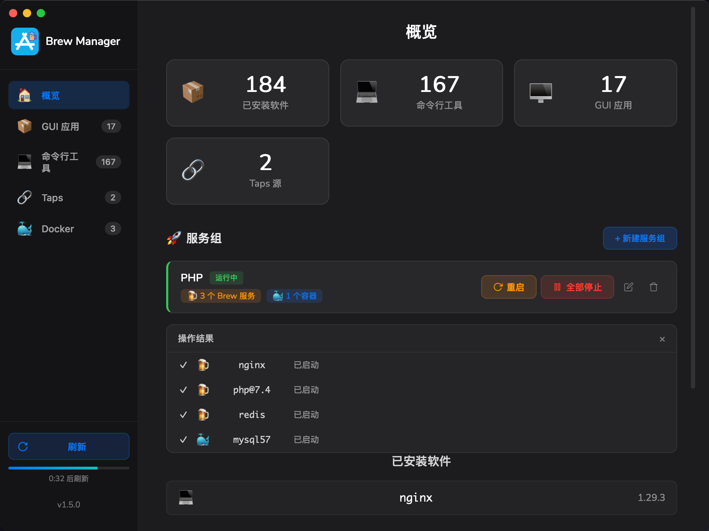
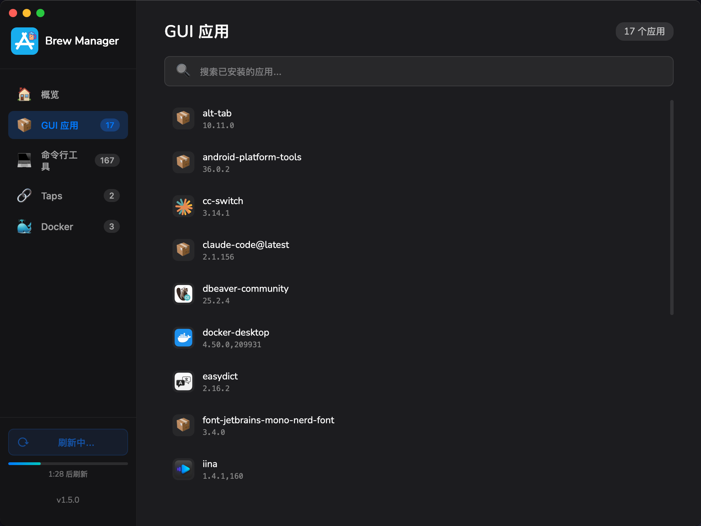
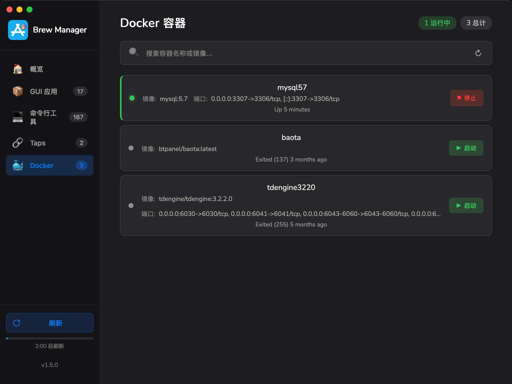
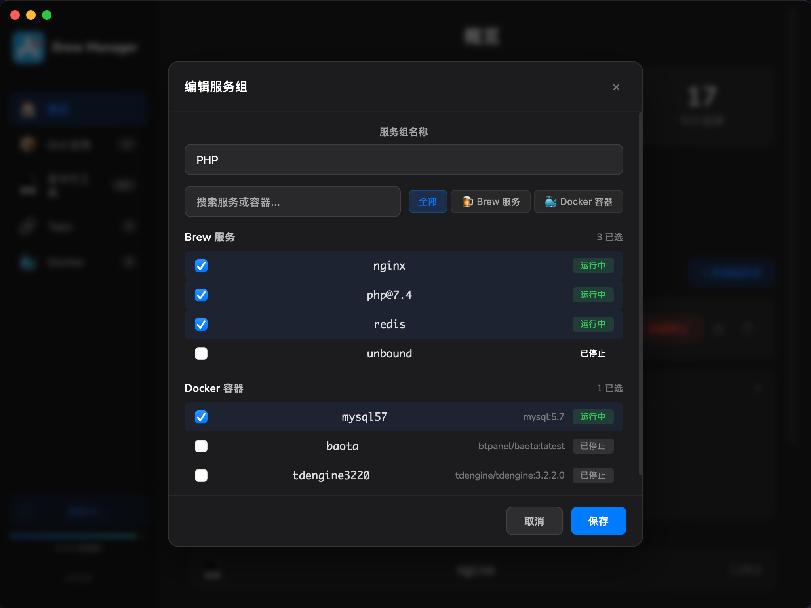

## 安装前确认

需要 **macOS Apple Silicon（ARM64）**。本机应已安装 [Homebrew](https://brew.sh/)；使用容器功能时，还需要 Docker Desktop。

### 01 · 下载与安装

前往 [Brew Manager v1.5.0](https://github.com/mycherish/brew-manager/releases/tag/v1.5.0)，下载 **`Brew-Manager-v1.5.0.dmg`**，打开后把应用拖入 **Applications**。

应用未进行 Apple 开发者签名。首次启动遇到系统阻止时，先确认下载来自该仓库，再参考 [README 的首次启动说明](https://github.com/mycherish/brew-manager#readme)。本页不要求所有用户先执行解除隔离命令。

### 02 · 管理日常环境

- **概览**：查看软件、服务和容器数量。
- **软件包与 Tap**：查看已安装软件、搜索安装，以及添加、移除和更新 Tap。
- **服务**：启动、停止或重启后台服务，观察状态变化和操作结果。
- **Docker**：查看容器，按需启动或停止；先准备 Docker Desktop。
- **LaunchPad**：新建服务组，选择 Brew 服务与 Docker 容器，再对整组执行操作。

### 界面预览

以下图片来自原产品介绍，展示不同页面；不作为本轮应用功能复验的证据。

### 更新与源码

`v1.5.0` 增加 LaunchPad 服务组和 Docker 容器管理，并改进按 Tab 刷新、图标加载与 Tap 查询。完整记录见 [GitHub Releases](https://github.com/mycherish/brew-manager/releases)。

项目基于 Wails v2、Go、Vue 3 和 Vite。源码构建、开发环境和贡献方式统一维护在 [仓库 README](https://github.com/mycherish/brew-manager#readme)，产品页不重复维护开发命令。
