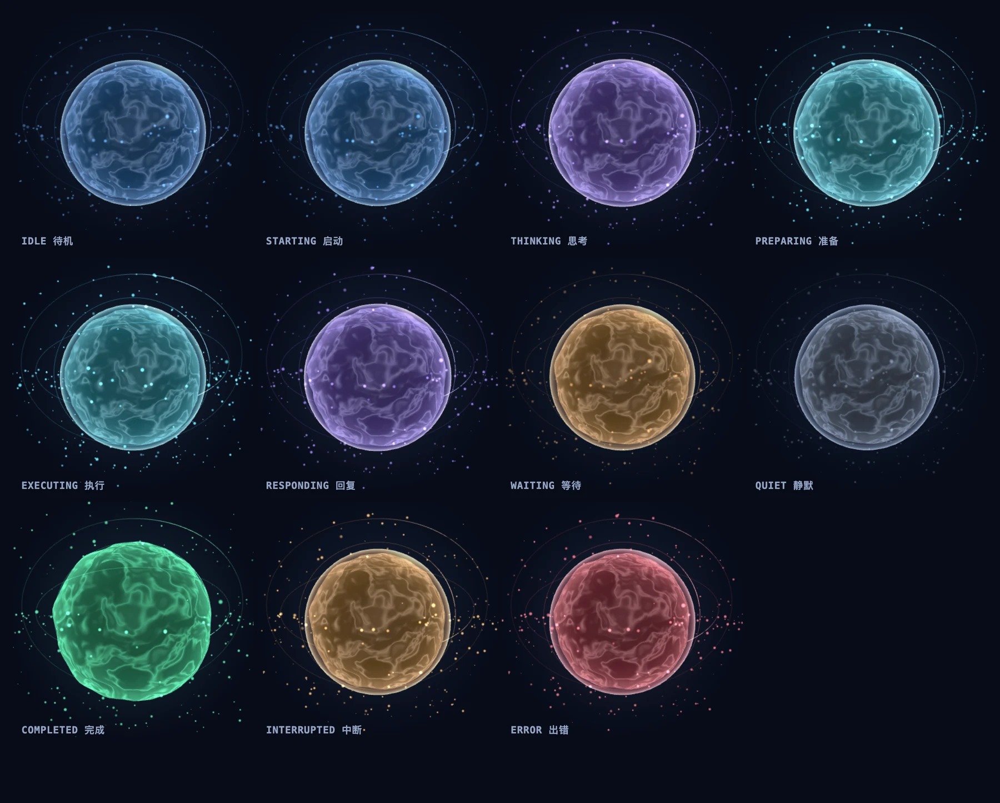

## 安装前确认

宿主范围为 **DSH `>=0.2.2-rc.1 <0.3.0-0`**；Node.js 为 **`^22.19.0 || >=24.0.0`**。通过本机 `localhost` 或 loopback 地址访问。

仓库记录了 **DSH `0.2.2-rc.1` / Desktop profile** 下的本机验证，并提供 Web profile 安装方式；不据此承诺其它宿主、系统和浏览器组合均已验收。详细边界见 [仓库 README](https://github.com/mycherish/dsh-orbis#readme)。

### 01 · 安装插件

```sh
dsh plugin --profile desktop add dsh-orbis@2.1.13
```

如果使用 `dsh web`，把 `desktop` 换成实际的 Web profile 名称。也可以在 **设置 → 插件 → 添加插件 → 安装第三方插件** 中填写 `dsh-orbis@2.1.13`。

安装后刷新一次 Harness 页面，启用插件，再让 Agent 开始一轮任务。界面会按所选模式显示进度卡或状态球。

国内网络需要镜像时：

```sh
dsh plugin --profile desktop add dsh-orbis@2.1.13 --registry=https://registry.npmmirror.com
```

镜像可能存在同步延迟。已有 `link:` 开发安装时不要用 npm 命令覆盖，开发说明见仓库。

### 02 · 按习惯显示

| 模式     | 常驻形态                   | 操作           |
| -------- | -------------------------- | -------------- |
| 自动展开 | 活跃时进度卡，空闲时收成球 | 展开或收起     |
| 始终紧凑 | 一行状态胶囊               | 打开完整工作区 |
| 仅能量球 | 76px 状态球                | 打开完整工作区 |

点击球打开工作区；`Esc` 关闭。拖动可调整球的位置，悬停查看状态，点击面板的固定按钮可保持展开。设置还提供帧率、粒子、轨道、光效和减少动态效果等选项。

### 03 · 读懂状态

蓝色表示空闲或启动，紫色表示思考或回复，青蓝表示执行工具，琥珀表示等待确认或中断，绿色表示完成，红色表示错误。静默状态显示真实时长，不等于已经卡死。



### 数据与运行边界

插件只读观察，不执行工具、不修改会话、不写数据库，也不新增模型调用。仓库的隐私说明列明事件字段与脱敏规则；不把这些说明扩展成对所有部署方式的安全保证。

仅支持本机访问；请求头过滤不是身份认证。不要直接把 DSH 暴露到局域网并把该过滤视为访问控制。更多说明见 [仓库安全与环境说明](https://github.com/mycherish/dsh-orbis#readme)。

### 卸载

```sh
dsh plugin --profile desktop remove dsh-orbis
```

Web 用户改用实际 profile。浏览器可能保留面板位置、折叠状态等 `orbis.*` 本地偏好；卸载不等于清空所有浏览器数据。
