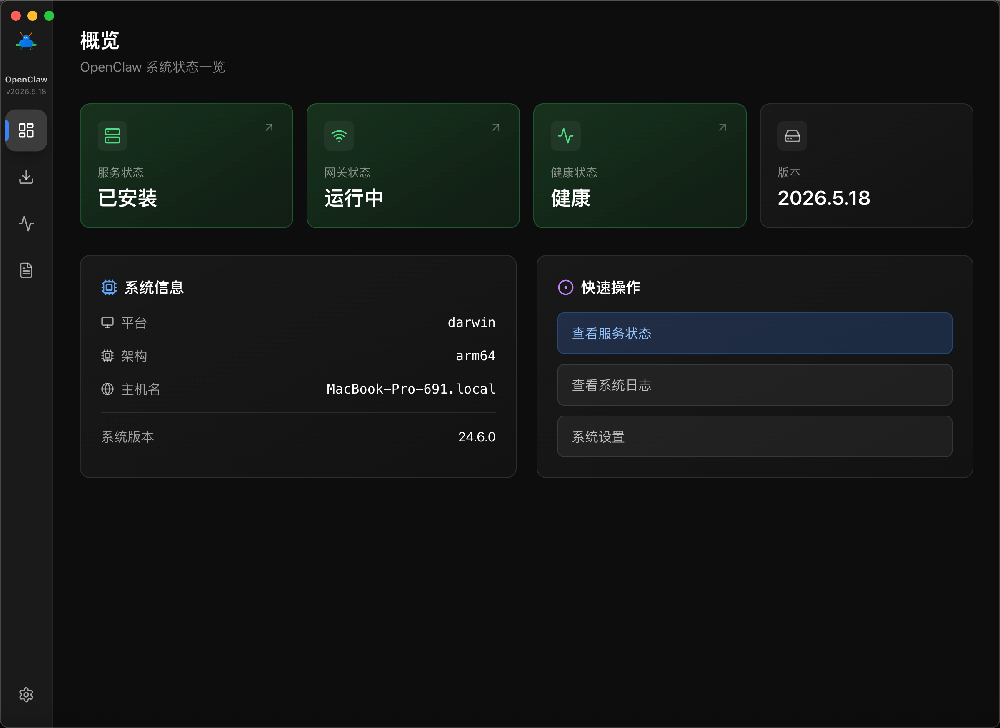
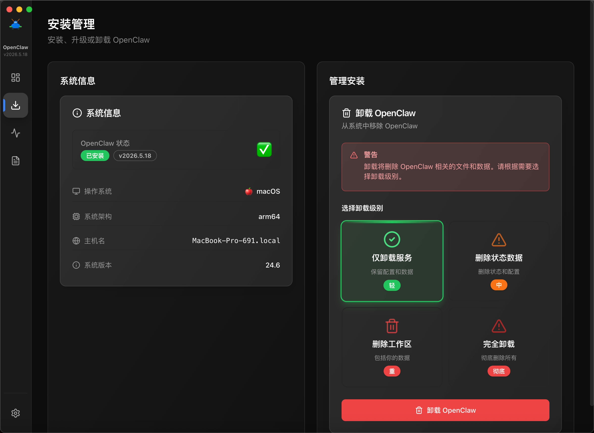
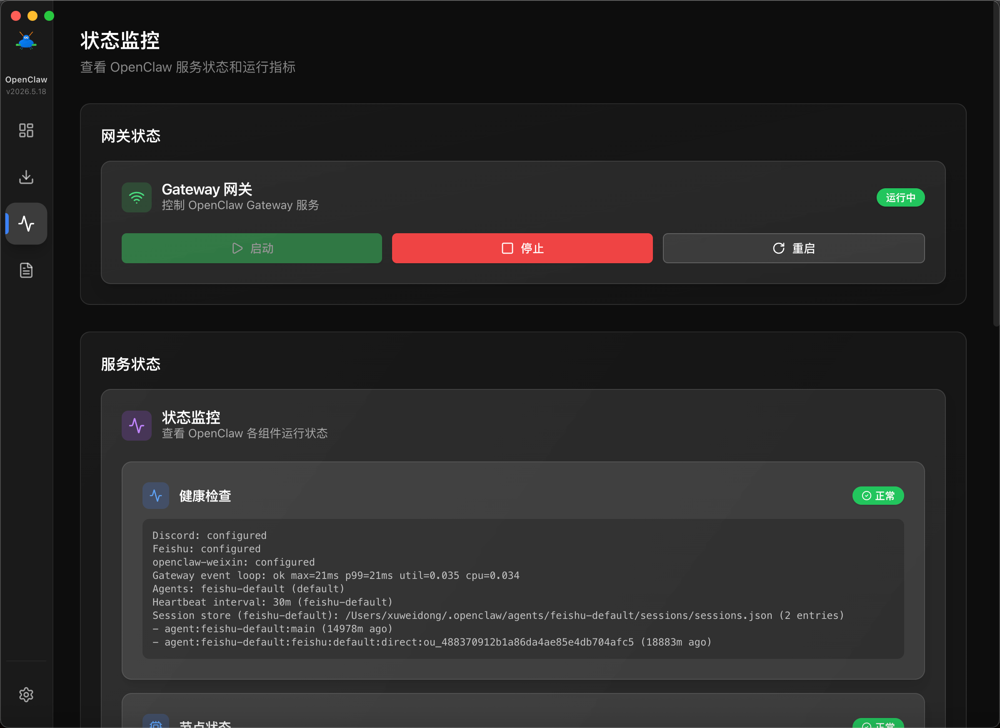
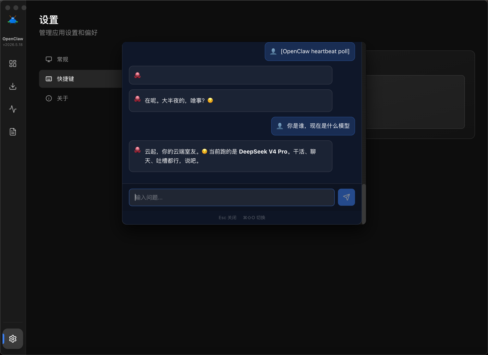

## 下载前确认

当前公开版本为 **`v1.0.0`**，发布附件是 **`OpenClaw.CoralUI-1.0.0-arm64.dmg`**，面向 **macOS ARM64 / Apple Silicon**。

**当前未提供 Windows 或 Linux 安装包。** README 中的跨平台描述和构建配置表示源码提供相应方向，不应当理解为已有可下载且完成验收的全平台版本。

### 01 · 安装公开版本

打开 [OpenClaw CoralUI v1.0.0](https://github.com/mycherish/openclaw-coralui/releases/tag/v1.0.0)，下载上述 DMG，按安装界面操作。

首次启动、OpenClaw 检测与所需权限，见 [仓库 README](https://github.com/mycherish/openclaw-coralui#readme)。请确认提示对应的实际操作，再授予所需权限。

### 02 · 准备 OpenClaw 环境

CoralUI 管理的是 OpenClaw 服务。请按仓库说明准备 OpenClaw，启动应用后检查概览中的安装与网关状态，再使用服务和日志页面。

### 当前源码功能与快捷键

仓库当前源码介绍了系统托盘、Quick Chat 浮窗、开机自启、本地设置保存和自定义快捷键。原文章将这组功能写成“v1.1.0 新功能”，但当前公开 Release 仍只有 `v1.0.0`；本页不再把它们当作已发布 v1.1.0 的承诺。

| 快捷键                 | 源码介绍中的操作     |
| ---------------------- | -------------------- |
| `Cmd/Ctrl + Shift + O` | 切换 Quick Chat 浮窗 |
| `Cmd/Ctrl + Q`         | 退出应用             |

快捷键可在源码版本的设置中调整。需要这些功能时，先核对仓库当前状态与构建说明；本轮没有重新验收应用或公开安装包。

### 界面预览

以下图片沿用原介绍，包含源码功能画面，不能用于证明公开安装包已拥有全部功能。

### 源码开发

项目基于 Electron、React、TypeScript 和 Vite。依赖安装、平台构建、目录结构及排障统一见 [仓库 README](https://github.com/mycherish/openclaw-coralui#readme)，产品页不重复维护整套开发说明。
